<div align="center">


<br/>

[](https://flutter.dev)
[](https://dart.dev)
[](https://github.com/HammasT1/watchstore_flutter/actions/workflows/build-apk.yml)
[](https://github.com/HammasT1/watchstore_flutter/releases/latest)

### Browse. Try on. Check out.

A dark, motion-rich watch storefront for Android, iOS, web, and desktop,<br/>
with a 3D product showcase, a gesture-driven try-on studio, and a glass-style checkout.

[**Download APK**](https://github.com/HammasT1/watchstore_flutter/releases/latest)
&nbsp;·&nbsp; [Features](#features)
&nbsp;·&nbsp; [Screenshots](#screenshots)
&nbsp;·&nbsp; [Architecture](#architecture)
&nbsp;·&nbsp; [Getting started](#getting-started)


</div>

<table>
<tr>
<td width="320" align="center">
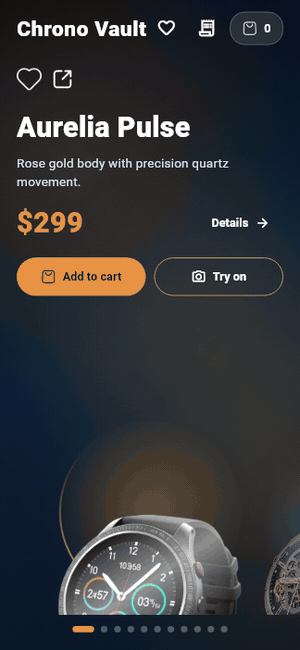
</td>
<td valign="top">

### At a glance

**A showcase built around the watch.** Open any watch and it flies in from the carousel, turns once, and settles into a hover with comets orbiting it. Drag it to tilt it in 3D.

**A complete shopping flow.** Favorites, a cart with quantities, a checkout preview, and an order history, all saved on the device.

**One accent per watch.** Each watch carries its own color, which drives the price, buttons, glow, and the aurora behind it.

**A small, readable codebase.** Two runtime dependencies, one shared store, and animation pieces that are plain widgets and painters.

| | |
| --- | --- |
| Watches in the catalog | 11 |
| Screens | 6 |
| Runtime dependencies | 2 |
| Platforms | Android, iOS, web, Linux, macOS, Windows |

</td>
</tr>
</table>

> [!NOTE]
> **Status: prototype.** The catalog is hard-coded and the checkout is a UI preview. Cart, favorites, and orders are saved on the device. There is no backend or payment processing, and order status is simulated from the time elapsed.

## Features

### Motion

| | |
| --- | --- |
| **3D carousel** | Swipe through the catalog in a coverflow that turns, scales, and fades. The watch in focus floats, catches a sweep of light, and sits in a rotating halo. |
| **Watch showcase** | The watch flies in, spins, and hovers among orbiting comets and glints. Drag to tilt it in 3D; it springs back on release. Specs slide in and the price counts up. |
| **Aurora theming** | A slow aurora takes the accent color of the current watch and blends between colors as you swipe. |
| **Fly to cart** | Adding a watch throws it along an arc into the cart badge, which bounces when it lands. |
| **Finishing touches** | The heart bursts when you favorite, totals count to their new value, and an order confirmation draws a tick with confetti. |

Idle animations pause when the device asks for reduced motion.

### Shopping

| | |
| --- | --- |
| **Favorites** | Save watches with the heart, review them on their own screen, and move them to the cart. |
| **Cart** | Change quantities, swipe to remove, and undo. Line totals and the cart total update as you go. |
| **Try-On Studio** | Pinch to zoom, rotate with two fingers, and drag to place a watch over a wrist guide. |
| **Smart Checkout preview** | A frosted-glass sheet with an animated delivery ETA and payment selection. |
| **Order history** | Each order keeps its items, payment method, and a status timeline. |
| **Saved on device** | Favorites, cart, and orders survive restarts. |

## Screenshots

<div align="center">

**Browse**

<table>
  <tr>
    <td align="center">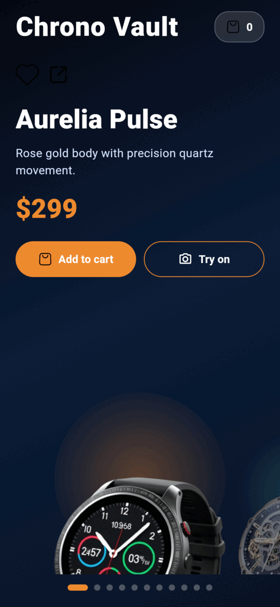<br/><sub><b>Home</b></sub></td>
    <td align="center">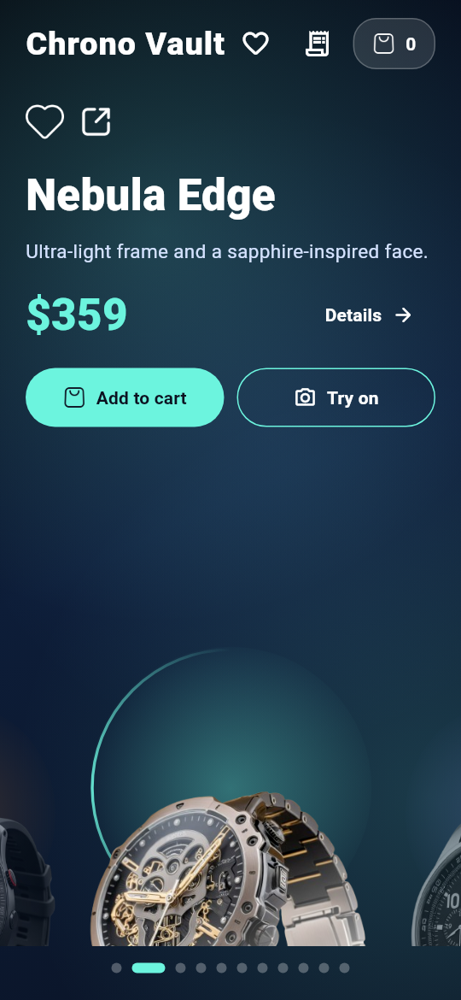<br/><sub><b>Carousel</b></sub></td>
    <td align="center">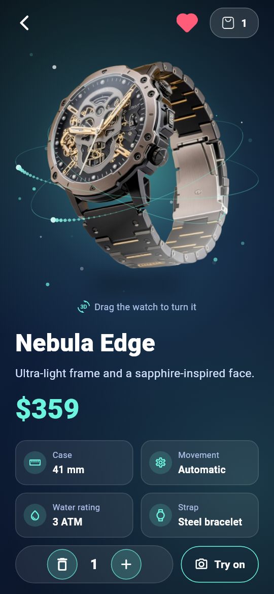<br/><sub><b>Showcase</b></sub></td>
  </tr>
</table>

**Choose**

<table>
  <tr>
    <td align="center">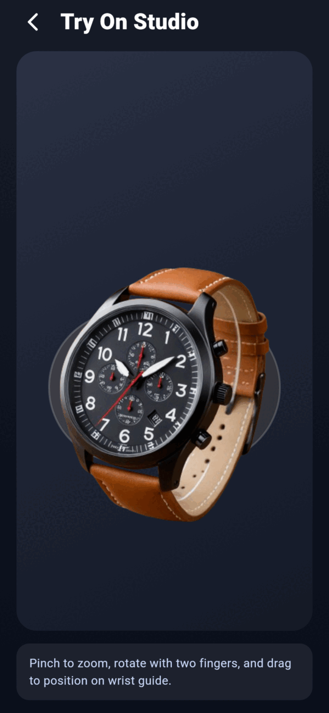<br/><sub><b>Try-On Studio</b></sub></td>
    <td align="center">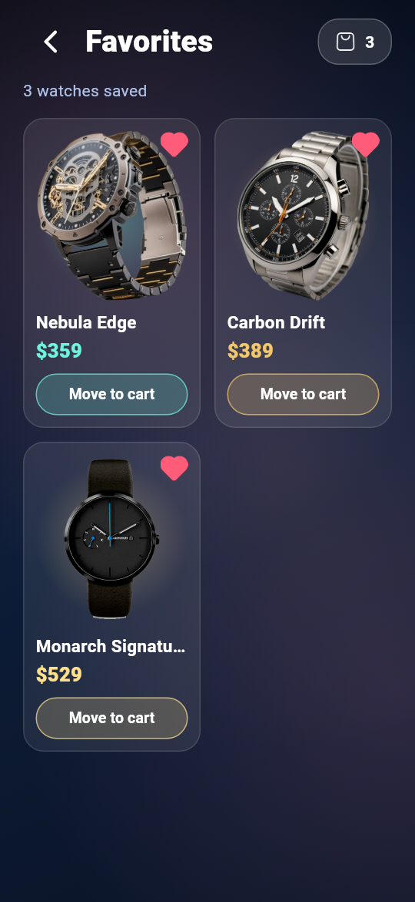<br/><sub><b>Favorites</b></sub></td>
    <td align="center">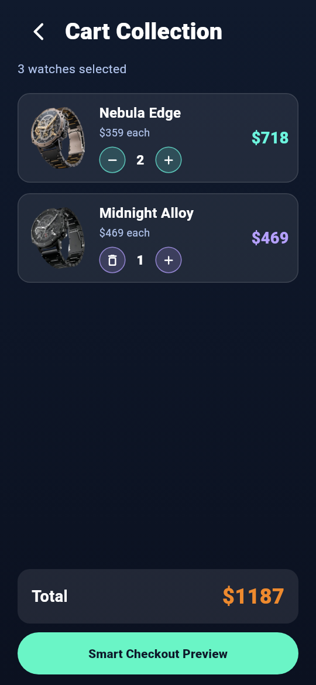<br/><sub><b>Cart</b></sub></td>
  </tr>
</table>

**Check out**

<table>
  <tr>
    <td align="center">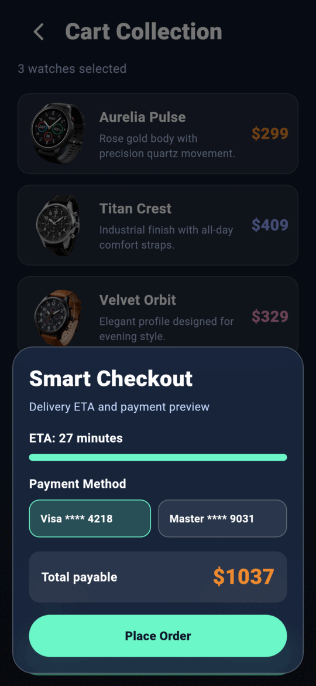<br/><sub><b>Smart Checkout</b></sub></td>
    <td align="center">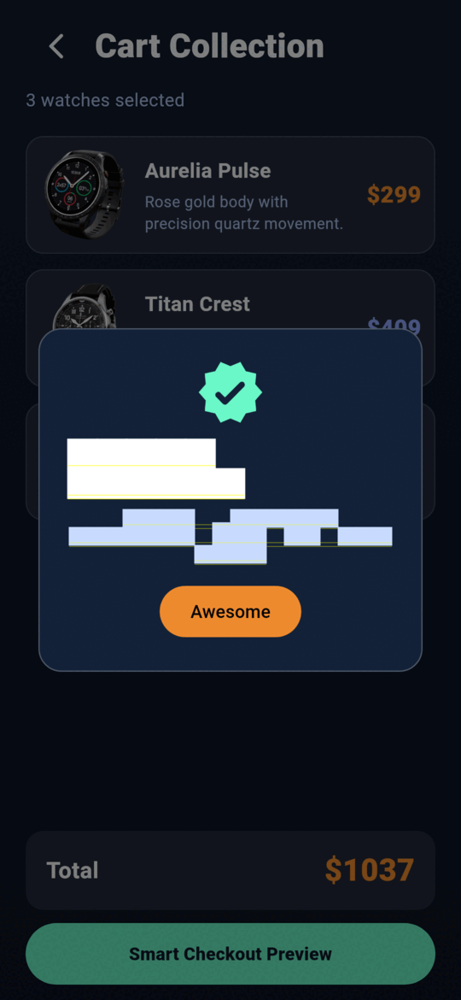<br/><sub><b>Order placed</b></sub></td>
    <td align="center">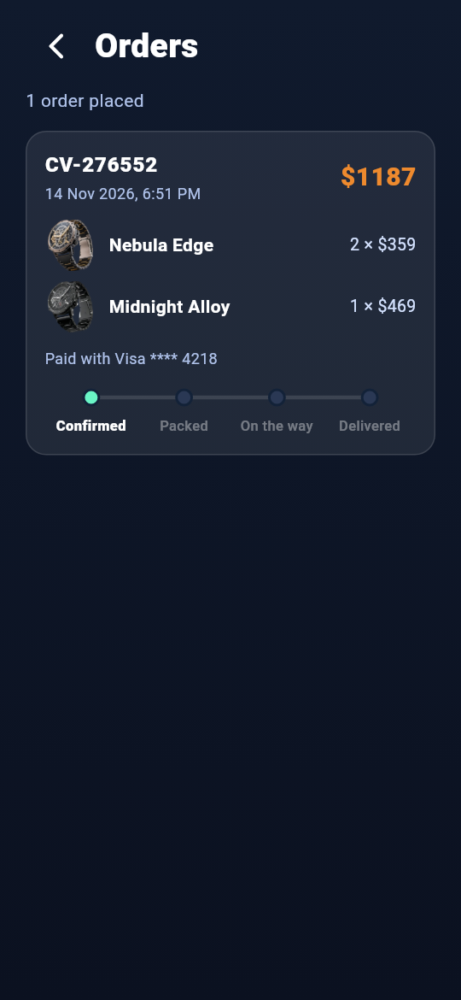<br/><sub><b>Orders</b></sub></td>
  </tr>
</table>

<sub>The screenshots and the demo are rendered from the app's own widgets at 360×780 logical pixels with Flutter's test renderer. They are not captures from a physical device.</sub>

</div>

## Architecture

State lives in one place. A `StoreController` holds favorites, cart quantities, and orders, saves them on every change, and is shared with every screen through an `InheritedNotifier`. Screens read from it and call its methods; none of them own shopping state.

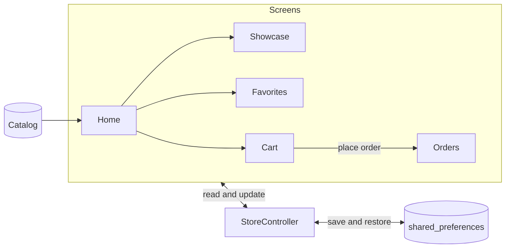

| Component | Responsibility |
| --- | --- |
| [`StoreController`](lib/state/store.dart) | Favorites, cart quantities, and orders, saved with `shared_preferences` |
| [`WatchStoreHome`](lib/screens/home_page.dart) | 3D carousel, product summary, cart and favorite actions |
| [`WatchDetailPage`](lib/screens/detail_page.dart) | Showcase, specs, and quantity controls |
| [`WatchShowcase`](lib/widgets/watch_showcase.dart) | Floating, tiltable watch with orbits, glints, and a light sweep |
| [`FavoritesPage`](lib/screens/favorites_page.dart) | Saved watches and move to cart |
| [`CartPage`](lib/screens/cart_page.dart) | Cart lines, quantities, total, and checkout |
| [`OrdersPage`](lib/screens/orders_page.dart) | Order history and status timeline |
| [`TryOnPage`](lib/screens/try_on_page.dart) | Gesture-driven try-on studio |
| [`effects.dart`](lib/widgets/effects.dart) | Reusable animation pieces: aurora, shine, orbits, fly to cart |

<details>
<summary><b>Project structure</b></summary>

<br/>

```
watchstore_flutter/
├── lib/
│   ├── main.dart          # App entry point and theme
│   ├── data/              # Hard-coded catalog
│   ├── models/            # WatchItem, Order
│   ├── state/             # Store: favorites, cart, orders, persistence
│   ├── screens/           # Home, detail, favorites, cart, orders, try-on
│   └── widgets/           # Animation effects, showcase, checkout sheet
├── assets/images/         # Product images and UI icons
├── docs/                  # README banner, demo, and screenshots
├── test/                  # Store and widget tests
├── .github/workflows/     # CI: APK build and release
└── android/ ios/ web/ linux/ macos/ windows/
```

</details>

## Design system

A deep-navy dark theme with an orange primary and a teal secondary. Each watch adds its own accent on top.

| Role | Color | Hex |
| --- | --- | --- |
| Primary |  | `#EE8A2E` |
| Secondary |  | `#63E5D7` |
| Surface |  | `#131B2C` |
| Background |  | `#0B1120` |
| Checkout accent |  | `#6AF5C6` |

## Tech stack

| Area | Details |
| --- | --- |
| Framework | Flutter, Material 3, dark theme |
| Language | Dart `^3.9.2` |
| State management | `ChangeNotifier` store shared through an `InheritedNotifier` |
| Persistence | `shared_preferences` |
| Animation | Flutter's own animation, transform, and custom-paint APIs; no animation packages |
| Linting | `flutter_lints` |
| CI/CD | GitHub Actions: analyze, test, and build the APK; release on version tags |

## Getting started

### Prerequisites

- [Flutter SDK](https://docs.flutter.dev/get-started/install) with Dart 3.9.2 or later
- A configured target: Android, iOS, web, or desktop (Linux, macOS, Windows)

```bash
flutter doctor
```

### Install and run

```bash
git clone https://github.com/HammasT1/watchstore_flutter.git
cd watchstore_flutter
flutter pub get
flutter run                 # default connected device
flutter run -d chrome       # web
flutter run -d linux        # desktop (or macos / windows)
```

### Test and analyze

```bash
flutter analyze
flutter test
```

The tests cover the store (quantities, orders, persistence) and the main flows through the UI: add to cart, the showcase page, favorites, and checkout.

### Build

```bash
flutter build apk --release   # Android
flutter build web             # Web
flutter build linux           # Desktop (or macos / windows)
```

## Releases and CI

[`build-apk.yml`](.github/workflows/build-apk.yml) analyzes, tests, and builds a release APK on every pull request to `main` and on every `v*` tag. Tag pushes also publish a GitHub Release with the APK attached.

```bash
git tag -a v1.1.0 -m "Release v1.1.0"
git push origin v1.1.0
```

> [!IMPORTANT]
> Release APKs are signed with the debug key, which is fine for testing and sideloading but not for Play Store distribution.

## Roadmap

- [x] Split `main.dart` into feature-based modules
- [x] Persist cart and favorites
- [x] Product detail page, favorites screen, and order history
- [ ] Load the catalog from a remote data source
- [ ] Integrate a real payment provider
- [ ] Live camera try-on
- [ ] Native sharing
- [ ] Search, filter, and sort

## Contributing

1. Fork the repository and create a feature branch.
2. Follow the lints in `analysis_options.yaml`.
3. Run `flutter analyze` and `flutter test` before submitting.
4. Open a pull request describing the change.

<div align="center">


<sub>Built with Flutter by <a href="https://github.com/HammasT1">Muhammad Hammas Rasheed</a></sub>

</div>
